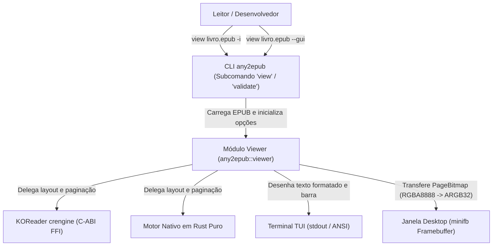
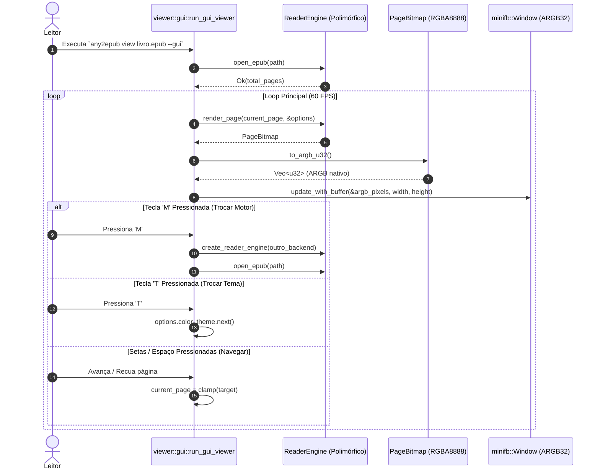

# Arquitetura do Motor de Visualização Multi-Engine e GUI Desktop

Este documento descreve a topologia arquitetural do módulo de visualização (`src/viewer/`) do `any2epub-rs`, implementado com padrão Strategy para desacoplar a apresentação do motor de paginação editorial (KOReader `crengine` e Rust puro).

---

## 1. Nível 1: Diagrama de Contexto de Sistema (System Context)

Mostra a interação do leitor/desenvolvedor com o subsistema de leitura, a CLI e os motores editoriais:



---

## 2. Nível 2: Diagrama de Contêineres e Módulos (Container / Top-Level Architecture)

Ilustra o isolamento entre a camada CLI, a abstração da biblioteca e os adaptadores de visualização:

```mermaid
graph LR
    subgraph any2epub Binário & Biblioteca
        Args["cli::args (CliArgs / CliCommand)"]
        Runner["cli::runner (Orquestrador)"]
        Validator["epub::validator (W3C EPUB 3.3)"]
        Extractors["extractors (PDF, Markdown, Web, MediaWiki, Spec)"]
        ViewerFacade["viewer::mod (create_reader_engine)"]
    end

    subgraph Viewer Internals
        TraitEngine["viewer::engine::ReaderEngine (Trait)"]
        EngineNative["viewer::native::NativeRustReaderEngine"]
        EngineKoreader["viewer::koreader::KoreaderCrengineEngine"]
        Options["viewer::options (Theme, RenderOptions)"]
        Bitmap["viewer::bitmap::PageBitmap (RGBA8888)"]
        TUI["viewer::interactive (TUI Session)"]
        GUI["viewer::gui (minifb Window 60 FPS)"]
    end

    Args --> Runner
    Runner --> Validator
    Runner --> Extractors
    Runner --> ViewerFacade
    ViewerFacade --> TraitEngine
    TraitEngine <|-- EngineNative
    TraitEngine <|-- EngineKoreader
    TraitEngine --> Options
    TraitEngine --> Bitmap
    Runner --> TUI
    Runner --> GUI
    TUI --> TraitEngine
    GUI --> TraitEngine
```

---

## 3. Nível 3: Diagrama de Componentes do Módulo Viewer

Detalha o ciclo de vida de renderização de página e o chaveamento dinâmico em tempo real:



---

## 4. Temas Cromáticos Suportados

Os seguintes esquemas editoriais são pré-calibrados tanto para o terminal quanto para a interface desktop:

| Tema (`ViewerColorTheme`) | Fundo (`background`) | Texto (`foreground`) | Destaque (`highlight`) | Caso de Uso Recomendado |
| :--- | :---: | :---: | :---: | :--- |
| **`PaperWhite`** | `#FFFFFF` (255, 255, 255) | `#1A1A1A` (26, 26, 26) | `#0066CC` | Leitura padrão diurna em alta definição. |
| **`Sepia`** | `#FBF0D9` (251, 240, 217) | `#433422` (67, 52, 34) | `#8F5902` | Leitura confortável com baixa fadiga visual. |
| **`Night`** | `#1E1E1E` (30, 30, 30) | `#CCCCCC` (204, 204, 204) | `#4DA6FF` | Leitura noturna em ambientes escuros (Dark Mode). |
| **`EInkMono`** | `#F5F5F5` (245, 245, 245) | `#000000` (0, 0, 0) | `#555555` | Simulação de telas E-Ink monocromáticas e e-readers. |
